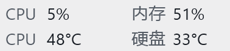

<p align="center"></p>

# WinTaskbarMonitor

一个简洁的 Windows 11 任务栏硬件监控工具。贴在天气右侧，用两行显示 CPU 占用率、内存占用率、CPU 温度和硬盘温度。当前开发版检测到 GPU 后，从左到右显示 CPU、GPU、内存/硬盘三列，支持驱动可识别的外接显卡。

GPU 与右键菜单 DPI 改进尚未发布，下面的 1.0.2 下载包及截图对应此前版本。实现、实测与温控曲线调研见 [2026-10-20 开发记录](docs/2026-10-20-gpu-dpi.md)。



```text
CPU  50%        内存  50%
CPU  50°C       硬盘  50°C
```

开发版检测到 GPU 时：

```text
CPU  50%    GPU  50%    内存  50%
CPU  50°C   GPU  50°C   硬盘  50°C
```

## 下载与安装

从 [Releases](https://github.com/zorichen/WinTaskbarMonitor/releases/latest) 下载：

- **WinTaskbarMonitor-1.0.2-Setup-x64.exe**：安装版，包含开始菜单入口、可选桌面快捷方式、登录自启动选项和卸载程序。
- **WinTaskbarMonitor-1.0.2-Portable-x64.zip**：免安装版，解压后运行 `TaskbarMonitor.exe`。运行数据仍存放在用户的 LocalAppData 目录。
- **SHA256SUMS.txt**：下载文件的 SHA256 校验值。

系统要求：Windows 11 x64、.NET Framework 4.7.2 或更新版本。初版针对主屏底部、图标居中的任务栏；副屏、垂直任务栏和第三方任务栏替换软件尚未验证。

程序启动会请求管理员权限，用于读取 CPU 和磁盘温度。首次安装可勾选 **PawnIO 温度驱动**；该选项默认不勾选，已有驱动时不会重复安装。也可以从 [PawnIO 官网](https://pawnio.eu/) 安装官方签名版。没有可用传感器时显示 `—`。

安装包和应用目前没有商业代码签名证书。PawnIO 安装包保持原始官方签名，下载后可核对校验值。

## 使用

- 右键小组件或托盘图标：查看传感器来源、重新检测显卡、微调左右位置、保存诊断报告或退出。
- 双击：查看详细读数和小组件内存占用。
- 自动适应系统浅色/深色主题以及屏幕缩放。
- 不上传遥测数据。

### 登录自启动

从 v1.0.1 起，安装包提供可选的 **登录后自动启动**，默认不勾选。安装时启用后，任务管理器 → 启动应用中会出现带应用图标的 **WinTaskbarMonitor**，可以在那里禁用或重新启用。

普通权限启动器在登录后等待 15 秒，再调用安装时授权的管理员计划任务读取温度。任务本身没有登录触发器，因此禁用启动应用入口后，不会从另一条路径自动启动。实际出现时间还受 Windows 启动应用调度影响。

自启动绑定到运行安装程序的 Windows 账户；如果提权时输入了另一个管理员账户的凭据，绑定的也是该管理员账户。每个安装目录使用独立任务和快捷方式。重新安装时取消此选项或卸载应用，会删除该安装记录的启动入口与任务，保留监控设置和共享 PawnIO 驱动。

便携版需要放在固定目录，再在管理员终端运行 `TaskbarMonitorStartup.exe --install-startup`；移动或删除目录前，先运行 `TaskbarMonitorStartup.exe --remove-startup`。日常登录启动器不需要再次确认 UAC。启动诊断写入 `%LOCALAPPDATA%\TaskbarMonitor\startup-launcher.log`。

| 数据 | 采样方式 | 间隔 |
| --- | --- | --- |
| CPU 占用率 | `GetSystemTimes` 忙碌时间比例 | 1 秒 |
| 内存占用率 | `GlobalMemoryStatusEx` 物理内存占用 | 1 秒 |
| CPU 温度 | LibreHardwareMonitor，优先 CPU Package | 每次采集完成后等待 5 秒 |
| 磁盘温度 | NVMe 综合温度等主温度传感器 | 每次采集完成后等待 5 秒 |
| GPU 核心温度与占用率 | LibreHardwareMonitor 的 NVIDIA / AMD / Intel GPU 传感器 | 每次采集完成后等待 5 秒 |

启用 CPU、磁盘和 GPU 硬件采集。后台采样，只重绘数值变化的区域。CPU 使用忙碌时间口径，可能与任务管理器某些版本的利用率口径略有差别。多块磁盘时显示主温度最高的磁盘，详情中标明来源。

GPU 显示默认优先 NVIDIA / AMD，其次 Intel；同组中选有核心温度且温度最高的设备。此规则是厂商优先级，不是内置/外置拓扑识别；详情保留全部设备名称、标识和读数。核心温度缺失显示 `—`，不会拿热点或显存温度替代。GPU 占用率与温度在同一次硬件采样中更新。

每隔至少 30 秒在下一次温度采样时重新枚举 GPU，发现启动后接入的显卡坞；“重新检测显卡”在下一轮采样时触发。没有支持的 GPU 时恢复原四项布局；只有不提供温度的核显时，仍保留 GPU 列并显示 `—`。驱动可能短暂缓存拔除前的读数，不能将此功能用作硬件保护。实机热插拔、休眠和多屏切换尚待验收。

一次旧版四项监控本机短时实测（16 逻辑处理器、45 秒）：进程平均 CPU 占用约 0.024%，平均工作集约 71.4 MiB。这不代表新增 GPU 采集后的资源占用，也不是所有硬件或长期运行的保证。

## 配置与诊断

数据目录：`%LOCALAPPDATA%\TaskbarMonitor`。安装和卸载不会删除这里的设置。

退出后可编辑 `settings.json`：

```json
{"LoadIntervalMs":1000,"TemperatureIntervalMs":5000,"LeftOffset":0,"WeatherWidth":160}
```

间隔最低为 1 秒和 5 秒。偏移、备用天气宽度以 96 DPI 逻辑像素计。默认使用天气按钮真实边界定位；识别失败时使用备用宽度。

诊断命令（管理员终端）：

```powershell
.\TaskbarMonitor.exe --diagnose
.\TaskbarMonitor.exe --capture-preview
.\TaskbarMonitor.exe --quit
```

`--diagnose` 约 7 秒后将结果写入数据目录并退出；`--capture-preview` 启动后保存一次组件自身的渲染图。`status.json` 每 30 秒更新，只保存在本地。诊断包含硬件型号和传感器标识，分享前请检查内容。

卸载 WinTaskbarMonitor 会移除程序和快捷方式，但保留用户设置与共享的 PawnIO 驱动。需要移除驱动时，请在 Windows“已安装的应用”中单独卸载 PawnIO。

## 从源码构建

Windows PowerShell 5.1 或 PowerShell 7：

```powershell
.\build.ps1
```

使用 Windows 自带的 .NET Framework C# 编译器，无需额外 SDK。首次构建自动从官方 GitHub Release 下载固定版本的 LibreHardwareMonitor 0.9.6，并校验 SHA256。

构建后运行 `.\tools\test-monitor.ps1` 检查 GPU 选择、过期读数、组件布局和当前显示器的右键菜单尺寸。会短暂打开独立测试窗口，不改安装与自启动。`-Hardware` 运行真实采样、重新枚举和只读风扇接口探测，输出到终端；需要管理员权限的传感器请在管理员终端运行。测试产物复用 `bin/`。当前程序只监控，不设置风扇曲线。

制作安装包需要 [Inno Setup 6 或 7](https://jrsoftware.org/isinfo.php)：

```powershell
.\package.ps1 -InnoCompiler 'C:\Program Files (x86)\Inno Setup 6\ISCC.exe'
```

结果在 `dist/`，包含安装包、免安装包和校验文件。`tools/package_icon.py` 使用 Pillow 从原图生成九档 ICO；常规构建直接使用仓库内已生成的 ICO。

自启动验证：先运行 `tools\test-startup.ps1 -Phase Prepare`，再依次以管理员运行 `-Phase Register`、普通用户运行 `-Phase Launch`、管理员运行 `-Phase Remove`。测试使用独立目录、任务和占位程序，不停止已安装的监控，不访问硬件。`tools\test-installer.ps1` 涉及同一个安装器 AppId；检测到正式安装时会拒绝执行，应在一次性 Windows 虚拟机内验证完整安装/卸载。

## 许可与参考

项目原创代码使用 [MIT License](LICENSE)。依赖保持各自许可，见 [第三方声明](THIRD-PARTY-NOTICES.md) 和 [参考项目](REFERENCES.md)。LibreHardwareMonitor DLL 保持独立且未经修改。

## 改名升级兼容

1.0.2 将产品名统一为 WinTaskbarMonitor。安装器 AppId、已有安装路径、内部可执行文件 `TaskbarMonitor.exe` / `TaskbarMonitorStartup.exe`、配置目录、单实例信号和计划任务标识保持不变，以原地升级已有安装并保留设置。新安装默认目录为 WinTaskbarMonitor，显示名称、开始菜单、桌面快捷方式和发布包采用新名。
